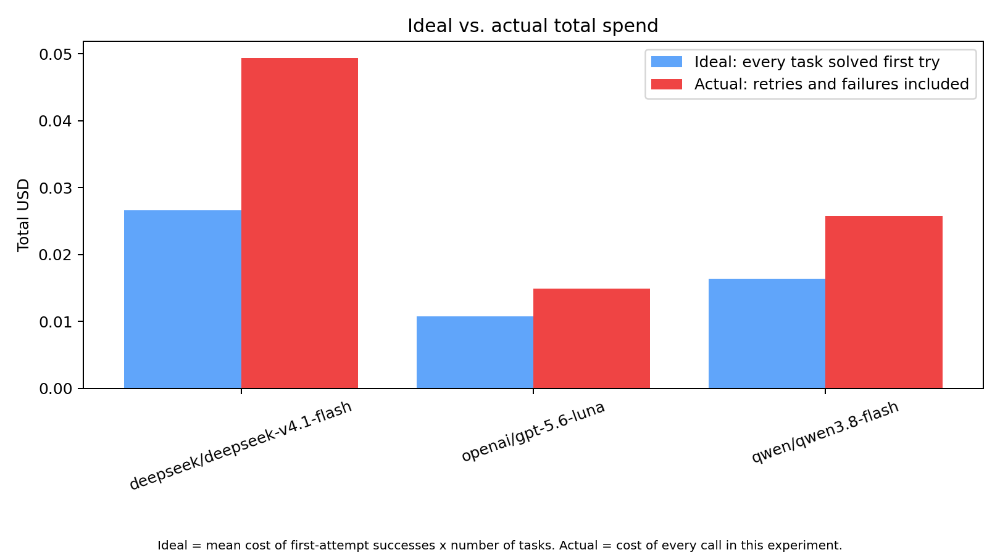
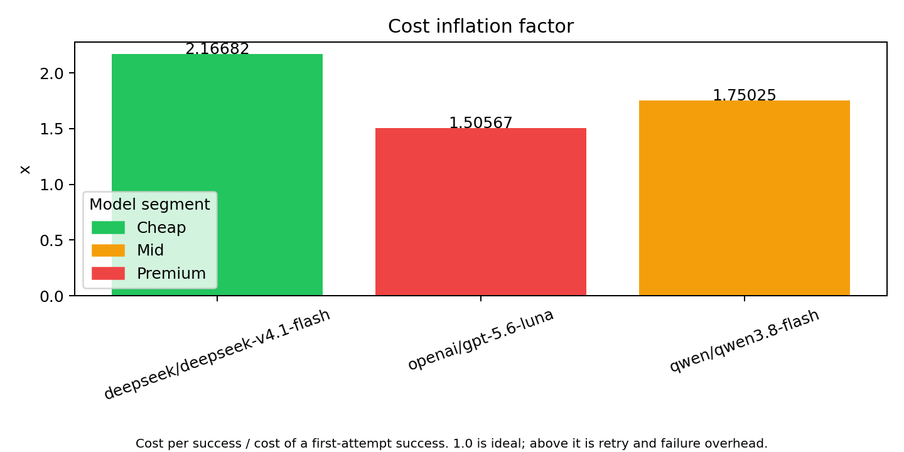
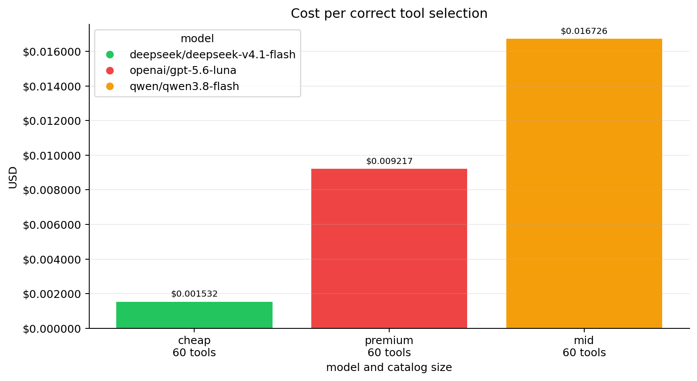
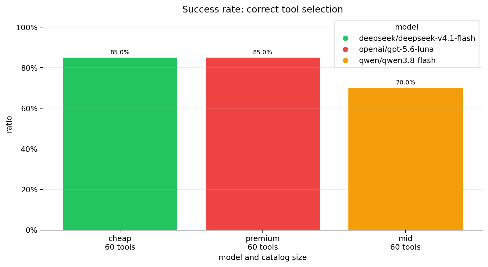
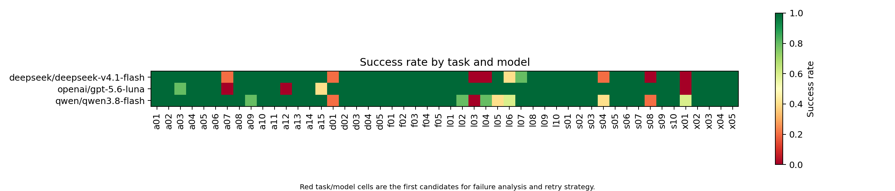

# llm-cost-per-success

**Is the cheap model really cheaper?** List prices per token say one thing; retries, wrong answers and bloated prompts say another. This project measures what an LLM costs **per successful result**, with two benchmarks that share one CLI:

| Benchmark | Question it answers | Command |
| --- | --- | --- |
| **General** | If a model must retry until its answer passes a judge, what does one *correct answer* really cost? | `python -m llm_cost_per_success general ...` |
| **Tools** | When an agent has 20-80 tools, what does tool routing cost per *correct tool selection*, with eager vs. deferred (on-demand) tool loading? | `python -m llm_cost_per_success tools ...` |

**Bring your own API key and choose any models you want to compare**: you pass model IDs on the command line, add their prices to `data/models.json`, and the benchmark does the rest. Nothing is hosted; every run uses your key and your budget.

Both talk to models through [OpenRouter](https://openrouter.ai) (the tools benchmark can also use the OpenAI API directly), and both save every raw run to CSV so results can be re-analyzed without new API calls.

## Examples

| General: ideal vs. actual spend | General: cost inflation per model |
| --- | --- |
|  |  |

| Tools: cost per correct tool selection | Tools: tool-selection accuracy |
| --- | --- |
|  |  |



## Quick start

Requires Python 3.10+ and an OpenRouter API key.

```bash
python -m venv .venv
source .venv/bin/activate        # Windows: .\.venv\Scripts\Activate.ps1
pip install -r requirements.txt
cp .env.example .env             # Windows: Copy-Item .env.example .env ; then add your key
```

Try the bundled sample first (no API key or cost):

```bash
python -m llm_cost_per_success general analyze --experiment examples/sample-run
```

## Benchmark 1: General (cost per successful task)

50 short tasks (arithmetic, logic, dates, strings, strict output formats) are sent to each model. A judge model checks every answer; on FAIL the task is retried, up to `--max-attempts`. All attempts are billed to the task.

```bash
python -m llm_cost_per_success general run \
  --models "openai/gpt-5.6-luna,qwen/qwen3.8-flash" \
  --repetitions 3 --name my-comparison

# re-create charts without calling any API
python -m llm_cost_per_success general analyze --experiment outputs/experiments/<folder>
```

Useful options: `--max-tasks 5` (cheap smoke test), `--max-attempts`, `--judge-model`, `--description`.

| Metric | Meaning |
| --- | --- |
| `cost_per_success` | Total cost of all attempts / number of successful tasks |
| `inflate` | `cost_per_success` / cost of a first-attempt success (1.0 = no retry overhead) |
| `waste_rate` | Share of total cost spent on tasks that never succeeded |
| `effective_*_price_1m` | List price scaled by tokens spent per token that ended in a success |
| `first_attempt_success_rate`, `retry_rate`, `p95_latency`, tokens per success | Supporting metrics |

Output goes to `outputs/experiments/<timestamp>-<name>/`: `experiment.json` (settings, judge rubric, task hash, prices), `runs.csv` (one row per model x repetition x task) and `analysis/` (`summary.csv` + charts). The judge's own cost is **not** included in the target metrics.

## Benchmark 2: Tools (eager vs. deferred tool loading)

A routing agent receives a catalog of 20-80 realistic function definitions (CRM, billing, calendar, email, GitHub, ...) and must call exactly one tool for each request. Two conditions run on identical tasks:

- **eager**: every tool schema is sent and immediately callable.
- **dynamic**: business tools use `defer_loading`; the model finds tools through hosted tool search.

```bash
python -m llm_cost_per_success tools run \
  --models "deepseek/deepseek-v4.1-flash,qwen/qwen3.8-flash" \
  --catalog-sizes 20,40,80 --max-tasks 20 --repetitions 3

python -m llm_cost_per_success tools analyze --experiment 003     # charts for one experiment
python -m llm_cost_per_success tools compare --experiments 003 004   # overlay several experiments
```

Start small when checking a new key: `--catalog-sizes 20 --max-tasks 3 --conditions eager`. Running several models with `tools run` analyzes each and builds a comparison automatically. Use `--provider openai` (with `OPENAI_API_KEY`) to call OpenAI directly.

Measured: tool-selection accuracy, input / cached / output / reasoning tokens, mean and p95 latency, estimated cost, cache savings, **cost per correct selection** and **spend wasted on wrong routing**. `expected_tool` is evaluation-only and is never sent to the model.

Notes for interpreting results:

- Each task is a stateless request; cache hits come only from a repeated prompt prefix, not conversation memory.
- OpenRouter does not reveal which tools tool search loaded, so that field stays blank instead of being guessed.
- Compare experiments only when task count, schema profile, catalog sizes, repetitions and prices match; use at least 3 repetitions before trusting small accuracy gaps.
- It measures routing, not whether the chosen tool would succeed downstream.

Output goes to `outputs/tool-experiments/NNN/` (`raw_runs.csv`, `summary.csv`, `catalog_stats.csv`, `run_metadata.json`, `tasks_snapshot.json`, `plots/`).

## Models and prices

Prices live in [data/models.json](data/models.json) (USD per million tokens, plus a `segment` of `cheap`, `mid` or `premium` used for chart colors). Add a model there before benchmarking it. Both benchmarks read it; the tools benchmark falls back to the price variables in `.env` for unlisted models.

## Project layout

```
llm_cost_per_success/
  __main__.py       CLI entry point (general / tools)
  general/          Benchmark 1
    runner.py         model calls, retry loop, judge, CSV + manifest
    analysis.py       metrics and charts
    tasks.py          task loading
  tools/            Benchmark 2
    runner.py         eager vs. deferred runs, cost model, CSV output
    catalog.py        the 80-function tool catalog and schema profiles
    analysis.py       charts for one experiment
    compare.py        overlay charts across experiments
data/
  tasks.json        50 general tasks (Turkish prompts)
  tool_tasks.json   24 tool-routing tasks (Turkish prompts)
  models.json       model prices and segments
examples/sample-run/  a committed general-benchmark run to try `analyze`
docs/images/        screenshots used in this README
outputs/            your experiment results (git-ignored)
```

## Contributing

See [CONTRIBUTING.md](CONTRIBUTING.md). Released under the [MIT License](LICENSE).

## Author

**Umut Şahin**: [GitHub](https://github.com/UmutSahin0) · [LinkedIn](https://www.linkedin.com/in/umutsahinn1/) · [Medium](https://medium.com/@umutsahinn1)
